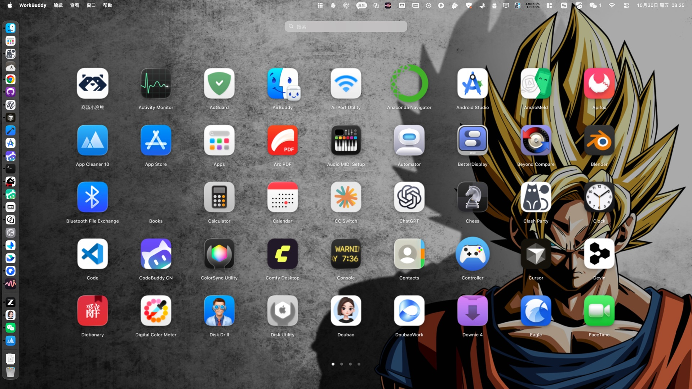

# LaunchPad · macOS 27 启动台复刻

macOS 27 移除了 Launchpad，这是一个用 **Swift + AppKit + Core Animation** 从零复刻的替代品：全屏模糊桌面、图标网格、分页、文件夹、搜索、拖拽重排、抖动编辑、全局热键，动效参数与性能预算都按原生 LaunchPad 的手感反向对齐。



## 功能

| 能力 | 说明 |
|---|---|
| 全屏启动 | 覆盖当前屏幕，出现在所有 Space，层级低于 Dock（Dock 依然可见，与原生一致） |
| 背景 | 读取当前桌面壁纸 → **一次性**预渲染高斯模糊图 → 打开时清晰图与模糊图交叉淡入 + 轻微放大 |
| 图标网格 | 自动扫描 `/Applications`、`/System/Applications`、`~/Applications` 及其 `Utilities`；9×5 / 7×5 自适应 |
| 分页 | 触控板双指左右滑（**左滑 → 下一页**，与原生一致）、滚轮、点击页码点；带橡皮筋与速度继承的弹簧吸附 |
| 文件夹 | 拖拽图标互相叠加即可建文件夹；点击文件夹从图标位置形变展开面板；支持面板内翻页、双击标题重命名 |
| 搜索 | 顶部搜索框，输入即过滤（支持中文拼音全拼、拼音首字母、英文词组首字母），结果从左上角重排，不匹配项淡出 |
| 拖拽 | 拖动图标时其余图标抖动，落位时弹簧让位；拖到屏幕边缘自动翻页；拖到图标上合并为文件夹 |
| 键盘 | 打字即搜索、方向键移动选择、`Return` 打开、`Esc` 逐层退出 |
| 全局热键 | 默认 `F4`（与原生一致），注册失败自动降级为 `⌥Space` |
| 程序坞 | Dock 常驻图标：**打开 App 即展开**；切到别的应用（点 Dock 图标、`⌘Tab`）**自动收起**，不会挡住别的 App；收起后点 Dock 图标 / `F4` 都能重新唤起 |
| 主菜单 | 应用菜单（关于 / 重新扫描 `⌘R` / 服务 / 隐藏 `⌘H` / 退出 `⌘Q`）、编辑菜单（`⌘Z` `⌘C` `⌘V` 等标准快捷键）、窗口菜单（显示启动台 `F4` / 关闭启动台） |

## 为什么用 AppKit + Core Animation

要"对齐原生"，关键不是写起来快，而是**动画必须跑在 render server 上、主线程每帧开销接近零**：

- 图标是 `IconLayer`（`CALayer` 子类，`contents` 为预栅格化 `CGImage`），一个 NSView 承载整屏图层，没有 `NSView` 层级开销、没有 SwiftUI 的 diff。
- 离散动画（入场波纹、翻页吸附、文件夹形变、让位重排）全部用 `CASpringAnimation` 交给 Core Animation，主线程只在动画开始时算一次参数。
- 只有连续手势（滚动跟随、橡皮筋）走自研弹簧 + `CVDisplayLink` 逐帧积分，`dt` 从 display link 取，60/120Hz ProMotion 自适应。
- 图标栅格化：内存 `NSCache` → 磁盘 PNG 缓存（`~/Library/Application Support/LaunchPadReplica/IconCache`）→ 后台 `CGImageSource` 解码 → 失败才回落到 `NSWorkspace`。

## 动效参数（`LaunchPad/Animation/Timing.swift`）

弹簧用 `response`（响应时间）+ `dampingRatio`（阻尼比）描述，运行时换算成 `CASpringAnimation` 的 `stiffness = (2π/response)²`、`damping = 4πζ/response`：

| 场景 | response | dampingRatio | 说明 |
|---|---|---|---|
| 背景模糊淡入 | 0.40 | 1.00 | 与窗口缩放同步，无回弹 |
| 网格整体入场 | 0.42 | 0.80 | `scale 0.94 → 1.0` |
| 单图标入场 | 0.36 | 0.72 | `scale 0.62 → 1.0`，按到网格中心的距离做波纹延迟（步进 10ms，上限 150ms） |
| 关闭 | 0.30 | 0.92 | 比打开更快，几乎无过冲 |
| 翻页吸附 | 0.42 | 0.90 | 继承手势速度作为初速度 |
| 图标让位 | 0.34 | 0.72 | 拖拽重排时的位置弹簧 |
| 文件夹形变 | 0.50 | 0.84 | 位置 / 缩放 / 圆角三属性同一条弹簧 |
| 按下 | 0.20 | 0.68 | `scale → 0.92` |
| 抖动 | — | — | `rotation ±1.6°`，周期 0.22s，随机相位错开 |

额外细节：右键/拖拽时图标阴影加强、标签带 1px 黑色投影保证壁纸下的可读性、页码点悬停放大 1.35×。

## 性能实测（1920×1080 @2x，90 个图层驻留）

```
bench layers=90 relayout=0.337ms/frame spring_settle=0.0ms(95 steps) offset=0.0001ms iconCacheHit=45/45 in 0.15ms
```

- 每帧主线程成本 **0.34ms**（120Hz 预算 8.3ms，占用约 4%）。
- 图层虚拟化：只实例化「当前页 ±1」的图层，137 个应用常驻图层 90 个。
- 滚动时每帧只写一个 `transform`，其余交给 GPU。

## 应用图标

图标由 `scripts/make_icon.py` **程序化生成**（Python + Pillow，无第三方二进制依赖），成品 `LaunchPad/Resources/AppIcon.icns`（10 个尺寸：16 → 1024@2x，经 `iconutil` 打包）。

设计语言对齐 macOS 启动台本身：

- **外形**：超椭圆 squircle（`|x/a|^n + |y/a|^n = 1`，`n = 4.6`），与系统图标轮廓一致，四角无生硬圆角。
- **底色**：蓝紫垂直渐变 `#7EB0FF → #4A6EF6 → #3A4AD6 → #242D96`，顶部亮、底部深。
- **主体**：3×3 圆角方块网格（图标语义 = 启动台的网格），主色白，第 2/4/6/8 格分别是青 / 橙 / 紫 / 绿，呼应系统应用的多彩。
- **质感**：每格 1px 内描边 + 顶部 22% 高度柔和光泽（alpha 58 → 0），不做厚高光。

```bash
python3 scripts/make_icon.py        # 重新生成 icns + docs/ 预览图
```

> 改配色只需调 `make_icon.py` 顶部的 `BG_STOPS` 与 `TILE_COLORS`，重跑即可，无需手工切图。

系统图标服务会缓存每个路径的图标。如果覆盖旧包后图标没刷新：

```bash
sudo rm -rf /Library/Caches/com.apple.iconservices.store
killall Finder Dock
```

（或把 App 拷到 `/Applications` 这类新路径，新路径没有缓存，会直接显示新图标。）

## 构建与运行

```bash
# 方式一：一键脚本（产物 dist/LaunchPad.app）
./scripts/build.sh Release

# 方式二：Xcode
xcodegen generate          # 工程由 project.yml 生成
open LaunchPadReplica.xcodeproj    # ⌘R 运行
```

安装与启动：

```bash
cp -R dist/LaunchPad.app /Applications/
open /Applications/LaunchPad.app     # 打开即展开启动台
```

启动后在 **Dock 中常驻显示图标**，随时可再次点开；收起后点 Dock 图标或按 `F4` 都能重新展开。

> 若你更想要「只驻留菜单栏、不占 Dock 位置」的旧行为，把 `project.yml` 里的 `LSUIElement: "YES"` 加回去，
> 并把 `LaunchPad/App/LaunchPadMain.swift` 的 `setActivationPolicy(.regular)` 改回 `.accessory` 即可。

### Spotlight 里出现多个 LaunchPad？

这不是装了两份 —— 是 **LaunchServices 注册了构建中间产物**。`xcodebuild` 会在 `.build/` 里也生成一份
`LaunchPad.app`，Spotlight 会把它的和 `dist/` 里的那份一起索引；被删掉的旧副本只要索引没刷新，也会残留一条
（这种残留项通常显示成空白图标，因为旧版本包里可能没有 `Resources/AppIcon.icns`）。

`scripts/build.sh` 已经做了防护：

- 给 `.build/` 加 `.metadata_never_index`，阻止 Spotlight 索引构建产物
- 构建后 `lsregister -u` 注销中间产物、`lsregister -f` 注册 `dist/` 那份

若历史上已经产生了重复项，把旧副本删掉（含回收站里的）后刷新索引：

```bash
mdfind "kMDItemCFBundleIdentifier == 'com.story5.launchpad'"   # 先看还剩几条
sudo mdutil -E /                                               # 重建索引（耗时较长，按需）
```

### 调试参数

```bash
LaunchPad.app/Contents/MacOS/LaunchPad --diag           # 打印屏幕/网格/分页/热键诊断
LaunchPad.app/Contents/MacOS/LaunchPad --bench          # 主线程性能基准
LaunchPad.app/Contents/MacOS/LaunchPad --slowmo         # 动画 4 倍慢放（逐帧验证动效）
LaunchPad.app/Contents/MacOS/LaunchPad --folder-demo    # 自动建一个文件夹并展开
LaunchPad.app/Contents/MacOS/LaunchPad --search-demo    # 自动输入 "co"
```

## 目录结构

```
LaunchPad/
├── App/LaunchPadMain.swift        @main、主菜单、调试开关
├── Animation/
│   ├── Timing.swift               弹簧参数表、CASpringAnimation 工厂、网格/文件夹度量
│   └── Spring.swift               标量弹簧积分器 + CVDisplayLink 帧驱动
├── Model/
│   ├── LaunchItem.swift           条目模型 + 搜索索引（拼音/首字母）
│   └── AppLibrary.swift           应用扫描、分页布局、拖拽编辑、布局持久化
├── Icon/IconStore.swift           图标解析/栅格化/内存+磁盘缓存/文件夹图标合成
├── UI/
│   ├── LaunchPadWindow.swift      全屏无边框窗口（所有 Space、Dock 之下）
│   ├── BackdropView.swift         壁纸 + 预模糊 + 变暗遮罩
│   ├── GridCanvasView.swift       网格/虚拟化/分页滚动/命中测试/拖拽重排
│   ├── IconLayer.swift            单个图标图层（缩放/抖动/淡入/启动弹跳）
│   ├── FolderPanelView.swift      文件夹面板（形变展开/内部翻页/重命名）
│   ├── SearchBarView.swift        搜索框（毛玻璃 + 自绘占位符）
│   └── PageIndicatorView.swift    页码点
├── Controller/LaunchPadController.swift   总控编排
├── Input/HotKeyCenter.swift       全局热键（Carbon RegisterEventHotKey）
└── Resources/AppIcon.icns         应用图标（由 scripts/make_icon.py 生成）

scripts/
├── build.sh                       一键构建（图标缺失时自动生成）
└── make_icon.py                   程序化生成 AppIcon.icns
```

布局、文件夹结构、排序持久化在 `~/Library/Application Support/LaunchPadReplica/layout.json`；删掉它即可恢复自动排序。

## 已知限制

- **不支持文件夹嵌套**（与原生一致）：把文件夹拖到另一个文件夹上不会合并。
- **不支持从文件夹里拖出**：面板内拖拽排序尚未实现，只能整组拖入生成文件夹。
- 动态壁纸（`.heic` 序列 / 航拍）取不到静态帧时会退化为纯色渐变背景。
- 图标来自 bundle 的 `.icns` / 资源目录；少数只用 asset catalog 且无 icns 的应用会走 `NSWorkspace` 兜底，首次加载略慢（之后进磁盘缓存）。
- 全局热键 `F4` 若被系统或其它工具占用，会自动降级为 `⌥Space`（启动日志 `hotkey=` 可查）。
- 拖拽重排/合并文件夹依赖真实鼠标手势，自动化只能覆盖到编译与静态检查，建议手动过一遍。

## 许可

[MIT](LICENSE) © 2026 Story5 —— 可自由使用、修改、分发，含商业用途；仅要求保留版权与许可声明，作者不承担任何担保责任。
